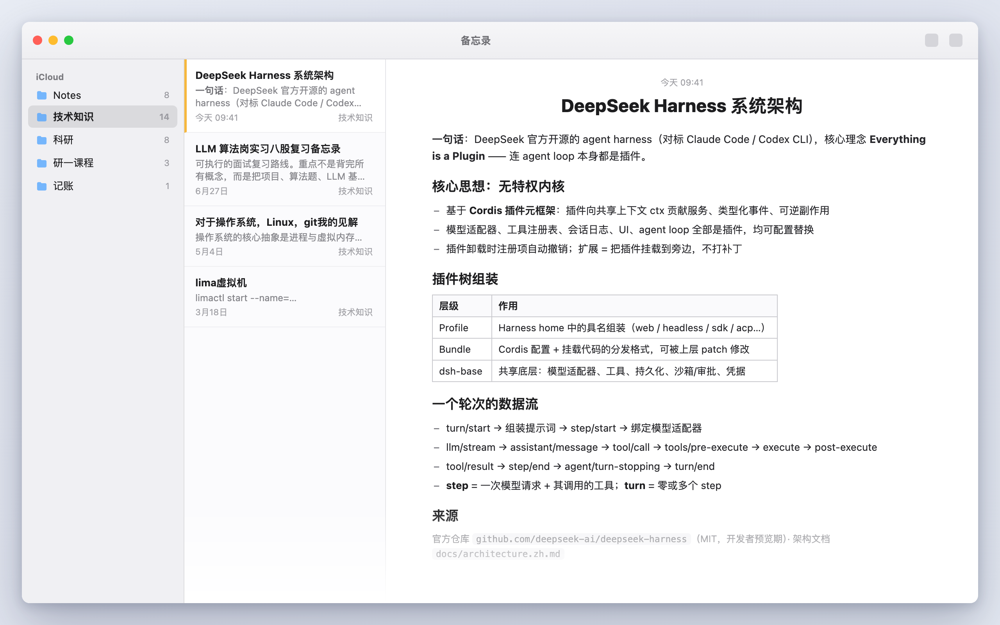

# mac-notes — Apple Notes agent skill（零依赖）

让 ZCode / Claude Code / Codex / Cursor 等任何本地 agent 直接操控 Mac 备忘录：**整理、搜索、撰写、富排版、导出**。单文件 JXA CLI，无 Node、无 MCP、无 Full Disk Access，输出 JSON。

> **v2.0.0**：完全重写。v1 基于 pinned MCP 后端（apple-notes-mcp + Node 运行时 + npm lockfile），依赖重、安装链路长；v2 换成零依赖单文件方案，接口怪癖全部实测沉淀。能力对照见下文。

## 演示：一句话，从网页到结构化笔记

把这段话发给你的 agent（ZCode / Claude Code / Codex / Cursor…）：

> 帮我从网上搜一下 DeepSeek Harness 的系统架构，整理成笔记放到备忘录。

agent 自动触发本 skill，完成 **联网搜索 → 整理成 Markdown → `create` 建笔记 → `apply-markdown` 写成原生富文本 → `open` 打开定位**，全程无需人工干预：



上面是真实输出（非效果图摆拍）：agent 检索 [deepseek-ai/deepseek-harness](https://github.com/deepseek-ai/deepseek-harness) 官方架构文档，把「Everything is a Plugin」架构笔记写进「技术知识」文件夹——注意表格、虚线列表、加粗标题都是备忘录**原生富文本**，不是 markdown 源码。

更多一句话用法：

- 「把备忘录里关于会议的笔记都归档到新建的『会议归档』文件夹」
- 「把『科研』文件夹整个导出成 Obsidian 库」
- 「给『推拉循环』这篇笔记排个版，开头加个总览表格」
- 「找一下我记过的健身计划，把今天的训练清单读给我」

## 安装

```sh
git clone https://github.com/YuanyuanMa03/apple-notes-agent-skill.git
cd apple-notes-agent-skill
bash install.sh            # 装到 ~/.agents/skills/mac-notes (跨工具通用目录)
```

可选目标：`bash install.sh zcode`（~/.zcode/skills）、`bash install.sh claude`（~/.claude/skills）、`bash install.sh /任意/路径`。

**首次运行**会触发 macOS 授权弹窗「…想要控制"备忘录"」→ 点**允许**。若曾被拒绝：系统设置 → 隐私与安全性 → 自动化 → 勾选你的终端 App 下的「备忘录」。

## 命令速查（16 个）

| 命令 | 作用 |
|---|---|
| `folders [--all]` | 文件夹树（path、noteCount） |
| `list [--folder F]` | 笔记列表，按修改时间倒序 |
| `search <词> [--folder F] [--deleted]` | 全文搜索（标题+正文），带摘要 |
| `show <id\|标题> [--html]` | 读笔记（纯文本 / 原始 HTML） |
| `open <id\|标题>` | 在备忘录 App 中打开定位 |
| `create --title T [--text X] [--folder F]` | 新建笔记 |
| `append <id\|标题> --text X` | 末尾追加 |
| `set-text <id\|标题> --text X` | 整体替换正文（保留标题） |
| `apply-markdown <id\|标题> (--file F\|--text M) [--append]` | **Markdown → 备忘录富文本**（真表格/原生列表/标题样式/加粗） |
| `rename <id\|标题> --title T` | 改名（标题与正文首行双向同步） |
| `mkdir <路径>` | 建文件夹（支持 `父/子` 嵌套） |
| `move <id\|标题> --folder F` | 移动笔记 |
| `delete <id\|标题>` | 删除 → 最近删除（30 天，可恢复） |
| `delete-folder <路径> [--force]` | 删文件夹（非空需 `--force`，自底向上删） |
| `export <id\|标题> [--out 目录]` | 单篇导出为 Obsidian 格式 .md |
| `export --folder F [--out 目录]` | 批量导出整个文件夹 |

成功输出 JSON（exit 0），失败输出 `[mac-notes] …` 及下一步建议（exit 1）。`<id|标题>` 优先用 id，标题唯一时可直接用标题，重名报错并列出候选。

```sh
NOTES=~/.agents/skills/mac-notes/scripts/notes
"$NOTES" search 水稻土                                # 全文搜索
"$NOTES" create --title "组会纪要" --text "要点…" --folder "科研"
"$NOTES" apply-markdown "组会纪要" --text "## 结论"$'\n'"- 项目可行"   # 富排版写入
"$NOTES" export --folder "科研" --out ~/Documents      # 导出为 Obsidian md
```

## 设计原理（为什么这些命令长这样）

全部接口行为在 macOS 26.7.1 上实测得出，细节见 [skills/mac-notes/references/quirks.md](skills/mac-notes/references/quirks.md)：

- **搜索不用 whose 子句**：`whose` 对新建笔记会报「不能获取对象」且更慢（社区实测慢 6.9×）。改为一次 Apple Event 批量拉属性 + JS 过滤，新建笔记秒级可搜。
- **标题 = 正文首行**：改写 body 首个 `<div>` 时 name 自动同步；只改 name 会造成 UI 标题与正文脱钩。
- **富文本走私有 HTML 方言**：表格需包 `<object>` + 内联边框样式、原生虚线列表用 `<ul class="Apple-dash-list">`、标题样式用粗体+字号模拟。

## 边界与限制（Apple 接口墙，非偷懒）

| 不支持 | 原因 |
|---|---|
| 置顶 (pin) | macOS 26 上 AppleScript 读写 `pinned` 均报「不能转换类型」，接口损坏 |
| 原生可打勾清单写入 | body 写入路径会清洗 div class，5 种方言变体实测全部被拍平 |
| 附件导出 | Notes 脚本接口不暴露附件对象（正文仅显示 `` 占位符） |
| 读取锁定笔记 | 端到端加密，`plaintext` 返回空串（列表标记 `locked: true`） |
| 彻底清空最近删除 | 对已删除笔记再次 delete 会失败，需在 App 中手动处理 |
| 语义 Heading 样式 | 写入 h2 会被规范化为「粗体+18px」模拟样式 |

## 兼容性

macOS 26.7.1 (Build 25G241) 单 iCloud 账户全命令实测通过。AppleScript 接口随 macOS 版本漂移，遇到异常优先看 quirks.md。

## v1 → v2

| | v1 (MCP 后端) | v2 (本版) |
|---|---|---|
| 依赖 | Node 20+、apple-notes-mcp 2.15.10、MCP SDK、npm lockfile | 无（macOS 自带 osascript） |
| 权限 | Automation + Full Disk Access (SQLite) + Shortcuts 导入 | 仅 Automation |
| 安装 | bootstrap 下载 Node → lockfile 安装 → 验收 | 复制 3 个文件 |
| 定位 | Skill + CLI + 可选原生 MCP | 单文件 CLI + SKILL.md + 实测文档 |
| skill 名 | `apple-notes` | `mac-notes`（卸载旧版后安装即可迁移） |

v1 的附件导出、原生标签、真 Heading 等能力来自 MCP/SQLite 通道，v2 以零依赖为优先取舍了这些；如需可并行使用 v1。

## License

MIT © YuanyuanMa03
